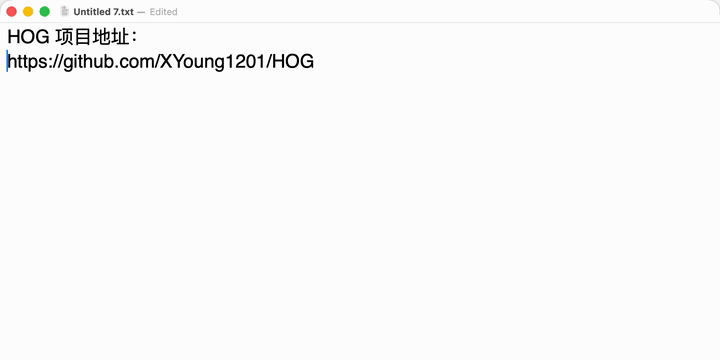
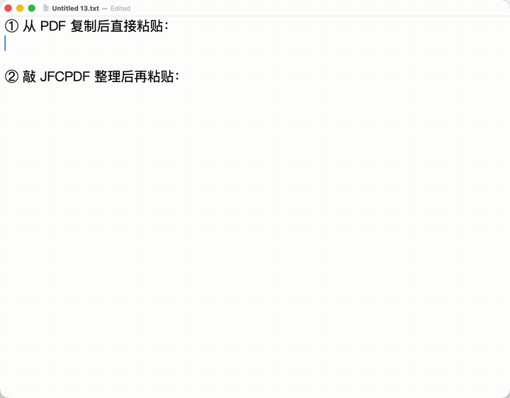
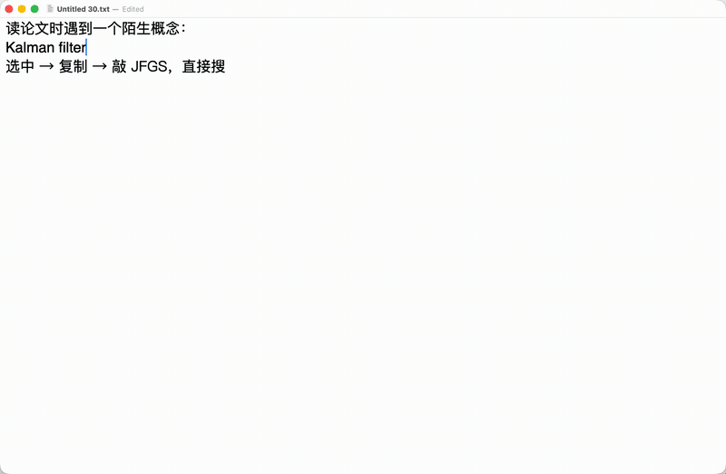
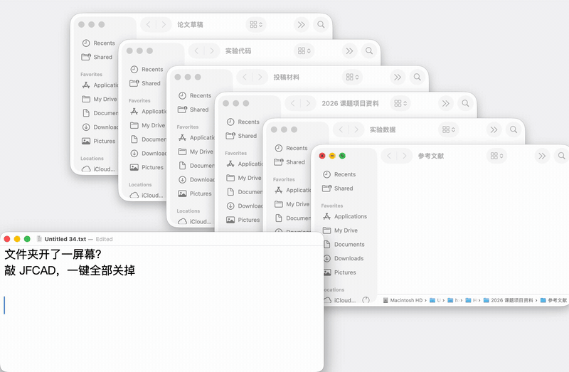
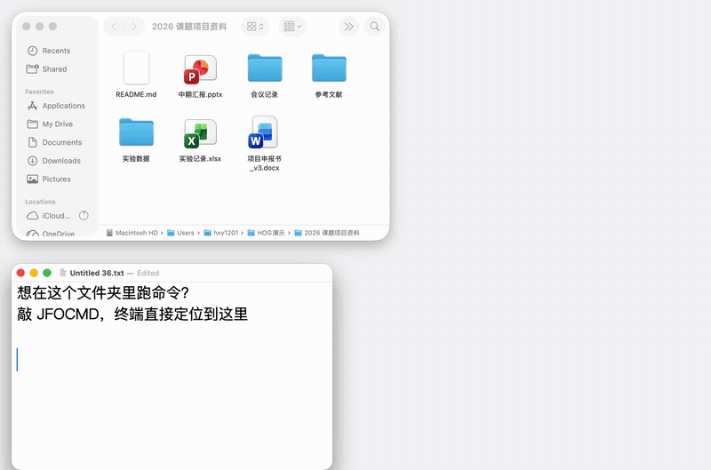
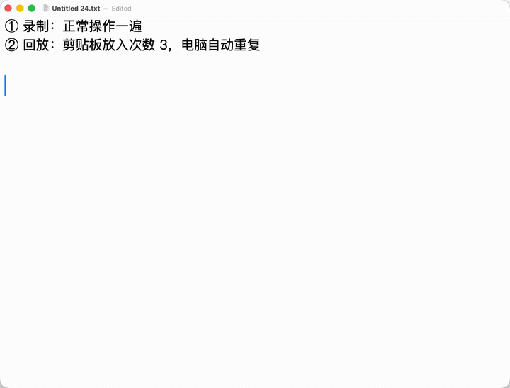

<!--
备选标题（任选其一）：
A. 敲 4 个字母，电脑就知道你要干什么
B. 我受够了每天找文件夹、删换行、传网址，于是写了个小工具
C. 你的注意力，正在被这些 3 秒钟的小事一点点偷走
-->

# 敲 4 个字母，电脑就知道你要干什么

> 一个让我每天少点几百次鼠标的小工具：HOG

---

你一定有过这样的时刻。

思路正顺，文档写到一半，忽然要翻一份资料。手离开键盘，握住鼠标，打开文件夹，点进去，再点进去，再点进去……终于找到了。回到文档，光标还在闪，刚才那句话想说什么，却忘了一半。

或者，从 PDF 里复制了一段文字，粘贴过来变成这样：

```
近年来，随着深度学习技术的快速
发展，越来越多的研究者开始关注
模型在实际场景中的泛化能力。
```

你叹口气，开始一行一行按删除键。

又或者，电脑上看到一个网址想发到手机。打开微信，找到文件传输助手，粘贴，发送，拿起手机，解锁，打开微信，点开，复制。**为了一行字，走了十步。**

这些事单拎出来，没有一件算得上麻烦。可它们一天会发生几十次，而且**偏偏挑你最专注的时候冒出来**。

真正被浪费的从来不是那几秒钟，而是一次次被打断后，**重新找回状态的那几分钟**。

我也被这些小事烦了很久。后来想：既然每次要做的事情都一样，为什么不能**给电脑一句"暗号"，让它直接做完？**

于是有了 HOG。

---

## 先看一眼：敲 JFQR，网址就到了手机上

复制一个网址，然后在键盘上依次敲下 `J` `F` `Q` `R`。



屏幕中央弹出二维码，手机一扫，网址就到了。没有打开任何软件，也没有碰鼠标。

这就是 HOG 的全部思路：**几个连续敲下的字母，就是一条指令。**

---

## HOG 是什么

**HOG（Hotkey Operated Gear）** 是一款轻量、开源的效率工具，有 **Windows** 和 **macOS** 两个原生版本。

它安静地待在菜单栏（或系统托盘）里，不弹窗口，不打扰你。你照常打字，它在后台听着。一旦你敲出的字母和预设的"暗号"对上，它就立刻执行对应的动作，**顺手把刚才敲的那几个字母删掉**，再在屏幕下方轻轻提示一句。

和 `Ctrl+Alt+某键` 这样的组合快捷键相比，字母暗号有三个好处：

- **好记**：`JFQR` 就是"二维码"，`JFYX` 就是"邮箱"，自己定的，自己记得住
- **不冲突**：不占用任何组合键，不会和其他软件抢快捷键
- **不误触**：选日常打字不会连着出现的字母（比如统一用 `JF` 开头），就不用担心误触发

---

## 那些打断你的小事，现在一步到位

### 打开文件夹、软件、网页：不用再一层层找

藏在五层目录里的项目文件夹、每天都开的那几个网站，各给一个暗号。想去哪里，敲几个字母就到。


### 常用文字：敲几个字母自动填好

邮箱、地址、手机号、那句每天要回复好几遍的"收到，谢谢"，存一次，以后敲暗号就自动填进去。


### PDF 复制的文字：一键变整齐

开头那段满是断行的文字，复制后敲一下暗号，再粘贴，就是一段完整的话。读论文、整理资料的人，会很喜欢这个功能。



### 电脑传手机：扫一下就到

就是开头演示的那个功能。传网址、传验证码、传一段笔记，都不用再绕道聊天软件。

### 常用网页：不翻书签，不输网址

项目主页、邮箱、学校系统、公司后台……每天要开的网页，各配一个暗号，敲完浏览器就直接跳过去。


### 选中就搜：遇到陌生概念，一步查到

读论文碰到一个没见过的术语，选中、复制，敲 `JFGS`，Google 搜索结果直接弹出来。不用切到浏览器，也不用点搜索框、粘贴、回车。



### 一键收拾：文件夹开了一屏幕，一下全关

翻资料时文件夹越开越多，桌面一团乱。敲 `JFCAD`，所有访达（资源管理器）窗口一次性关掉，桌面瞬间清爽。



### 写代码的朋友：在当前文件夹直接打开终端

在访达里找到了项目目录，想在这里跑个命令？敲 `JFOCMD`，终端直接打开，并且已经定位到这个文件夹，不用再手动 `cd` 一长串路径。



---

说到底，这些功能都不复杂。它们解决的是同一个问题：

**当你已经清楚自己要做什么，就不该再把时间花在找入口上。**

---

## 重复的点点点，录一遍交给电脑

还有一类麻烦，不在于找入口，而在于**一模一样的操作要做很多遍**：在同一个界面里反复点同一个位置、填相似的内容、按固定顺序走一遍流程。

HOG 可以**录下你的键盘和鼠标操作，再替你重复播放**：

1. 敲暗号开始录制，像平时一样操作一遍
2. 再敲一次，录制结束
3. 剪贴板里放上想重复的次数，敲回放暗号
4. 回放途中按 `P` 暂停或继续，按 `Q` 停止



*（演示中，连按 4 次左 ⌘ 开始 / 结束录制，连按 4 次右 ⌘ 回放；动图已加速 1.5 倍。）*

需要提醒的是，宏只是忠实地照着做，**并不理解屏幕上的内容**。界面一变就要重新录，所以它最适合步骤固定、重复性强的工作。

---

## 你的暗号，你自己定

所有暗号写在一份纯文本配置文件里，**一行一条**：

```
JFYX  TEXT:hello@example.com
JFGT  PATH:https://github.com/XYoung1201/HOG
JFXM  PATH:~/Documents/2026 课题项目资料
JFQR  CMD:QRCODE
JFGS  CMD:GOOGLESEARCH
```

- 敲 `JFYX`，自动填入邮箱
- 敲 `JFGT`，打开 HOG 的 GitHub 主页
- 敲 `JFXM`，打开项目文件夹
- 敲 `JFQR`，显示剪贴板二维码
- 敲 `JFGS`，用 Google 搜索剪贴板内容

`TEXT:` 输入文字，`PATH:` 打开文件、文件夹、程序或网址，`CMD:` 调用内置命令。三种写法，就能覆盖日常大部分需求。

改完保存，HOG 会**自动重新加载**。不用写代码，也不用重启。

Windows 和 macOS **用同一套配置写法**，换电脑时只需要改几个和系统相关的路径。

- **Windows 10 / 11**（x64、ARM64）
- **macOS 12 及以上**（首次运行需要授予"辅助功能"和"输入监控"权限，项目说明里有图文步骤）

---

## 写在最后

HOG 不想做一个接管一切的自动化平台，也不打算取代复杂的脚本工具。

它更像是你和电脑之间的**一套小暗号**：数量不必多，但每一条都是你自己最常用的那件事。用得越久，它就越贴合你的习惯。

如果你也常被这些小事打断，不妨试试。**从今天最烦你的那两三件小事开始**，给它们各起一个暗号。

你会发现，省下的不只是几秒钟，**还有那份没被打断的专注。**

---

## 获取 HOG

完全开源免费，欢迎试用、提建议，也欢迎点个 ⭐ Star 支持一下。

**GitHub 项目地址**
https://github.com/XYoung1201/HOG

**最新版本下载**
https://github.com/XYoung1201/HOG/releases/latest

*（公众号内外链无法直接点击，可复制到浏览器打开，或点击文末"阅读原文"。）*
